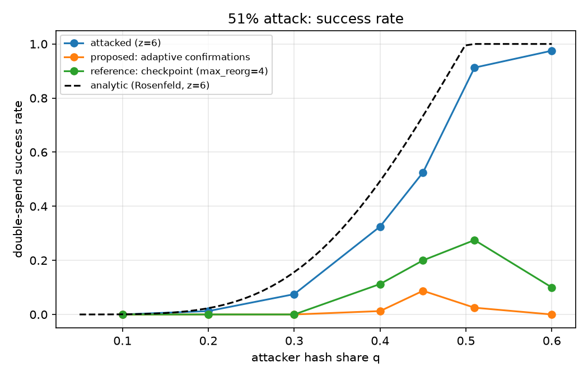
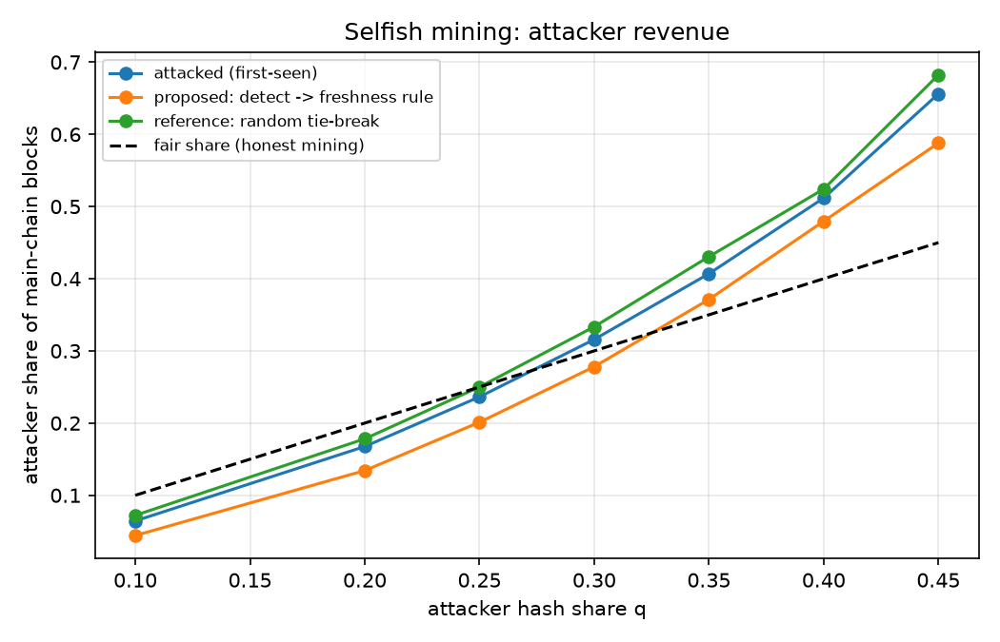
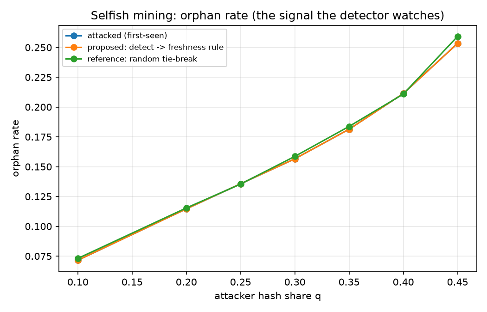
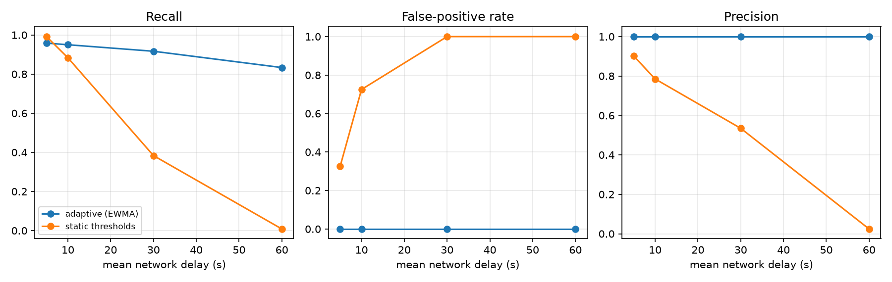
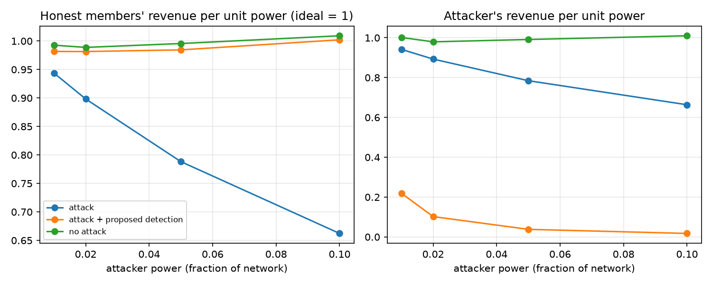
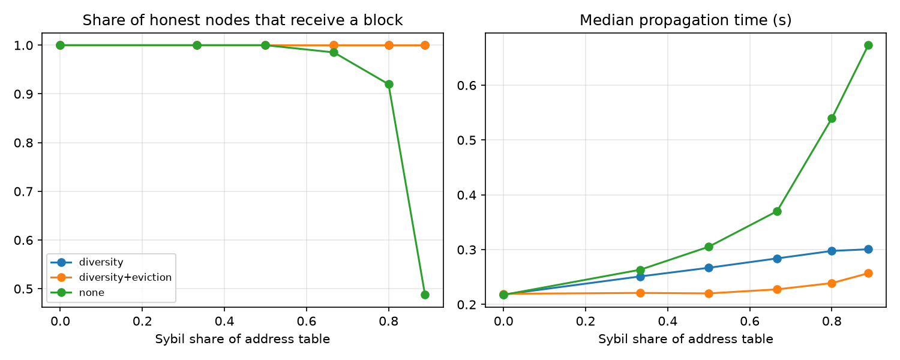

# Simulateur d'attaques sur blockchain PoW (Atelier 2)

Plateforme expérimentale permettant de **simuler, analyser et détecter** quatre attaques contre une blockchain Proof-of-Work : attaque des 51 % avec double dépense, Selfish Mining, Block Withholding dans une pool de minage et attaque Sybil dans un réseau P2P simulé. Une contribution est proposée : un **mécanisme adaptatif de détection** fondé sur les métriques du réseau, avec une contre-mesure adaptée à chaque attaque.

## Structure du dépôt

| Élément | Rôle |
|---|---|
| `src/core.py` | Simulateur réseau PoW à événements discrets, nœuds honnêtes, attaquant 51 % (double dépense) et attaquant Selfish Mining |
| `src/detector.py` | Détecteur adaptatif (contribution) et détecteur à seuils fixes (référence) |
| `src/pool_sybil.py` | Block Withholding dans une pool (détection + bannissement) et attaque Sybil / éclipse (détection + mitigation) |
| `experiments.py` | Lance toutes les expériences (graines fixes) et génère `results/` et `figures/` |
| `results/` | Tables CSV des résultats |
| `figures/` | Graphiques comparatifs |

## Installation et exécution

```bash
python -m venv .venv
.venv\Scripts\Activate.ps1        
pip install -r requirements.txt
```

Exécution complète (environ 8 min sur un PC standard) :

```powershell
$env:REPS=80; python experiments.py        
```
```bash
REPS=80 python experiments.py              
```

Test rapide : `REPS=10`. Toutes les simulations utilisent des **graines fixes** : les résultats sont **reproductibles** à l'identique.

## Modèle de simulation

- **Réseau** : la blockchain trouve en moyenne un bloc toutes les 600 s. Le gagnant de chaque bloc est tiré proportionnellement à sa part de hash rate. Les blocs se propagent avec un délai de 1 s + Exp(10 s). Règle de la chaîne la plus longue. Le nœud 0 sert d'observateur (et de commerçant).
- **PoW abstrait** : la découverte d'un bloc est un processus de Poisson (modèle standard de la littérature), sans calcul de hash réel.
- **Paramètres variés** : nombre de nœuds (10, 20, 50), part de hash rate de l'attaquant (0,1 à 0,6), délai réseau moyen (5 à 60 s), stratégies adverses.

## Les attaques implémentées

1. **51 % avec double dépense et réorganisation de chaîne** : l'attaquant mine honnêtement, paie un commerçant, mine en secret une chaîne parallèle ne contenant pas ce paiement, puis la publie une fois la marchandise expédiée (z confirmations) et la chaîne secrète plus longue.
2. **Selfish Mining** (Eyal & Sirer) avec stratégie de publication : l'attaquant retient ses blocs et les publie selon son avance (0 : course, 1 : tout publier, ≥ 2 : révéler juste assez).
3. **Block Withholding** dans une pool (paiement proportionnel) : l'infiltré soumet des parts (shares) pour être payé mais jette ses solutions complètes.
4. **Sybil / éclipse** dans un réseau P2P : la table d'adresses des nœuds honnêtes est inondée de faux nœuds qui ne relaient aucun bloc.

## Contribution : détection adaptative et mitigation

Le détecteur analyse une fenêtre glissante de 60 blocs et calcule :

- le **taux de blocs orphelins** ;
- le **délai de réception par mineur** (heure de réception − horodatage du bloc) : un bloc retenu puis publié a un délai énorme ;
- la **profondeur des réorganisations** de chaîne.

Il maintient une **moyenne et une variance glissantes (EWMA)** de chaque métrique, qui définissent le comportement « normal » du réseau. Une alerte est levée si le z-score du délai dépasse 5 **et** celui du taux d'orphelins dépasse 1 sur deux fenêtres consécutives, ou si une réorganisation de 5 blocs ou plus survient. La référence est gelée pendant un soupçon pour ne pas « apprendre » l'attaque. Les seuils suivent donc le réseau au lieu d'être fixés à la main.

| Attaque | Signal de détection | Contre-mesure adaptative |
|---|---|---|
| 51 % / double dépense | concentration du hash rate, réorganisation profonde | le commerçant ajuste le nombre de confirmations z pour que P(attaque) < 0,1 % selon la part maximale observée (+5 % de marge) ; il refuse le paiement si la part ≥ 50 % |
| Selfish Mining | z-scores du délai et des orphelins | après alerte, règle de départage « fraîcheur préférée » (les blocs retenus perdent les égalités) |
| Block Withholding | test de Poisson : blocs trouvés vs parts soumises (p < 1e-6) | bannissement du membre |
| Sybil | taux d'échec de relais par pair, concentration de préfixes | un seul pair par préfixe /16, éviction des pairs qui ne relaient pas |

**Mécanismes de référence comparés** : 6 confirmations fixes, checkpoint (rejet des réorganisations > 4 blocs), départage aléatoire (Eyal-Sirer), seuils statiques (taux d'orphelins > 5 %).

## Protocole expérimental

Trois configurations comparées : blockchain de référence (sans attaque), blockchain attaquée, blockchain protégée. 80 simulations par point (40 pour le Selfish Mining, 10 pour la pool, 5 pour Sybil), 300 blocs de chauffe avant le début de l'attaque. Métriques : taux de réussite de l'attaque, précision, rappel et taux de faux positifs, temps de détection, pertes économiques simulées (valeur d'un paiement : 20 unités, récompense d'un bloc : 1), surcoût des défenses (délai de confirmation, temps CPU du détecteur).

## Résultats

### Attaque 51 % : taux de réussite de la double dépense



| Part q de l'attaquant | 6 confirmations fixes | Checkpoint | **Confirmations adaptatives** | Délai de confirmation (fixe → adaptatif) |
|---|---|---|---|---|
| 0,30 | 7,5 % | 0 % | **0 %** | 4 480 s → 36 026 s |
| 0,40 | 32,5 % | 11,3 % | **1,3 %** (11 % refusés) | 5 258 s → 47 201 s |
| 0,45 | 52,5 % | 20 % | **8,8 %** (61 % refusés) | 5 686 s → 58 519 s |
| 0,51 | 91 % | 27,5 % | **2,5 %** (94 % refusés) | n/a |
| 0,60 | 97,5 % | 10 % | **0 %** (99 % refusés) | n/a |

Dans un réseau sans attaque, la règle adaptative ne coûte rien (z reste à 6). Le coût de la protection est la latence (jusqu'à environ 10 fois) et les paiements refusés quand q ≥ 0,45. Le succès simulé est inférieur à la formule analytique de Rosenfeld (0,49 à q = 0,4 contre 0,33 simulé) car notre attaquant abandonne après 10 blocs de retard.

### Selfish Mining




L'attaque devient rentable au-delà de q ≈ 0,2 (q = 0,3 : 31,6 % des blocs ; q = 0,4 : 51 %) et le taux d'orphelins passe de 2 % à 16-21 %. Le départage aléatoire aide peu, car l'attaquant, mieux connecté, gagne quand même les égalités. Avec la détection suivie de la règle de fraîcheur, la détection atteint 80 % (q = 0,1) à 100 % (q ≥ 0,35), en environ 25 à 38 blocs, et le revenu de l'attaquant tombe à 27,8 % à q = 0,3 (sous sa part équitable) et 48 % à q = 0,4. Une partie des dégâts survient avant la détection.

### Qualité de détection : adaptatif vs seuils statiques



| Délai réseau | Adaptatif : rappel / faux positifs | Statique : rappel / faux positifs |
|---|---|---|
| 5 s | 0,96 / 0,00 | 0,99 / 0,33 |
| 10 s | 0,95 / 0,00 | 0,88 / 0,73 |
| 30 s | 0,92 / 0,00 | 0,38 / 1,00 |
| 60 s | 0,83 / 0,00 | 0,01 / 1,00 |

La précision du détecteur adaptatif vaut 1,0 partout. Les seuils fixes s'effondrent dès que le réseau est plus lent que celui pour lequel ils ont été réglés. Le surcoût CPU du détecteur est de quelques millisecondes par simulation.

### Block Withholding



Avec un attaquant à 5 % de puissance, les membres honnêtes gagnent 0,79 par unité de puissance au lieu de 1,0 (−21 %). Avec le test de Poisson, l'attaquant est banni après environ 281 intervalles de blocs et le revenu honnête remonte à 0,98, avec 0 faux bannissement sur 30 pools honnêtes. Un petit attaquant se cache plus longtemps (1 % de puissance : environ 1 380 intervalles).

### Attaque Sybil



Sans défense, la part des nœuds honnêtes atteints par un bloc tombe à 92 % avec 800 Sybils et 49 % avec 1 600 (délai médian de propagation de 0,22 s à 0,67 s). Limiter à un pair par préfixe restaure 100 % de couverture. La détection par échec de relais identifie les pairs Sybil avec une précision d'environ 0,99 et un rappel de 1,0.

## Limites

- PoW abstrait (pas de hash ni de réseau réels) ; le PoS n'est pas couvert.
- Les horodatages de l'attaquant sont supposés honnêtes pour les métriques de délai et la règle de fraîcheur ; un vrai mineur égoïste pourrait les falsifier (dans la limite des règles de temps du consensus).
- Les Sybils sont supposés concentrés dans peu de préfixes ; un attaquant disposant de nombreux AS contournerait la limite par préfixe (la détection par échec de relais reste efficace).
- Un seul observateur décide des alertes et la contre-mesure est appliquée instantanément à tout le réseau ; un déploiement réel nécessiterait des décisions locales ou une diffusion des alertes.
- Le checkpoint provoque des scissions de chaîne quand q > 0,5 ; les confirmations adaptatives échangent de la latence contre de la sécurité.
- Block Withholding : une seule pool, un seul attaquant, paiement proportionnel.

## Références

- S. Nakamoto, *Bitcoin: A Peer-to-Peer Electronic Cash System*, 2008.
- I. Eyal, E. G. Sirer, *Majority is not Enough: Bitcoin Mining is Vulnerable*, 2014.
- M. Rosenfeld, *Analysis of Hashrate-Based Double Spending*, 2014.
- I. Eyal, *The Miner's Dilemma*, 2015.